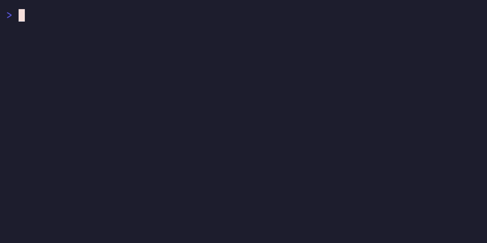

# agent-tty

Give your AI agent a real terminal it can drive, and get back reviewable snapshots, screenshots, and recordings of everything it did.

> It's like `agent-browser` / Playwright, but for terminal apps instead of web pages.

[](https://www.npmjs.com/package/agent-tty)
[](https://github.com/coder/agent-tty/actions/workflows/ci.yml)
[](./LICENSE)


[Quickstart](#quickstart) · [Why](#why-not-just-tmux-expect-asciinema-or-playwright) · [How it works](#how-it-works) · [Commands](#command-surface) · [Contributing](#contributing)



Tools like `tmux` or `screen` help _you_ manage your own terminal windows. `agent-tty` is for handing a real, long-lived terminal to an AI coding agent, so it can run commands, drive interactive apps like `nvim` or `htop`, and read the screen back. Because every session is recorded, you never have to take the agent's word for what happened: you (or another agent) get a plain-text snapshot, a real screenshot, or a video of the actual screen, and can replay it to check the work. It works just as well for plain shell automation and CI smoke tests with no agent involved.

## What you'd use it for

- **Proof you can review.** An agent runs a task and attaches the screenshot, video, or replayable recording to its PR, so a human can confirm at a glance that the change really worked, instead of trusting a log.
- **A tighter feedback loop.** Tell the agent to actually _use_ the TUI it just built or fixed, then read the screen back, so it catches a broken layout itself before you ever see it.
- **Reproducing terminal bugs.** Spin up a clean, isolated terminal, reproduce a flaky TUI bug report there, hand it to an agent to attempt a fix, and verify the fix with a fresh recording.

## Demos

Real Codex and Claude TUIs discovering the `agent-tty` skill, driving `nvim --clean`, writing a file, and exporting inner proof artifacts. (GitHub renders these as click-to-play players.)

<table>
  <tr>
    <th width="50%">Codex</th>
    <th width="50%">Claude</th>
  </tr>
  <tr>
    <td><video src="https://github.com/user-attachments/assets/f1823164-330c-4962-8adf-2b825080e06f" controls width="100%"></video></td>
    <td><video src="https://github.com/user-attachments/assets/966bed35-9383-444e-b06a-1d103ccba49a" controls width="100%"></video></td>
  </tr>
</table>

Full reproducer, transcripts, and proof bundles are in [`dogfood/agent-uses-agent-tty/`](./dogfood/agent-uses-agent-tty/) and [`dogfood/CATALOG.md`](./dogfood/CATALOG.md).

## Quickstart

Requires Node `>=24 <27`. Screenshots and WebM video also need a Playwright Chromium install (`npx playwright install chromium`).

```bash
npm install -g agent-tty

# Sessions, logs, and artifacts live under ~/.agent-tty by default.
# Optionally point AGENT_TTY_HOME at a throwaway dir for an isolated run:
export AGENT_TTY_HOME="$(mktemp -d)"
agent-tty doctor --json                  # check your environment

# The canonical loop:
SID=$(agent-tty create --json -- /bin/bash | jq -r '.result.sessionId')  # 1. open a session
agent-tty run "$SID" 'printf "hello from agent-tty\n"' --json            # 2. type into it
agent-tty wait "$SID" --text 'hello from agent-tty' --json               # 3. wait for the screen
agent-tty snapshot "$SID" --format text --json                           # 4. read it back
agent-tty screenshot "$SID" --json                                       # 5. capture proof
agent-tty destroy "$SID" --json                                          # 6. clean up
```

Driving an interactive TUI is the same loop, with key chords and a wait for the screen to settle:

```bash
agent-tty run "$SID" 'nvim --clean' --no-wait --json
agent-tty wait "$SID" --screen-stable-ms 1000 --json
agent-tty send-keys "$SID" Down Down Enter --json
agent-tty screenshot "$SID" --json
agent-tty record export "$SID" --format webm --json
```

More workflows are in [`docs/USAGE.md`](./docs/USAGE.md). Other install paths (tarballs, prerelease channels, source checkouts) are in [`docs/INSTALL.md`](./docs/INSTALL.md).

## Why not just tmux, expect, asciinema, or Playwright?

Those tools are good, and you can get partway with any of them. `agent-tty` exists because driving a terminal _and_ getting reviewable evidence back is awkward with each one:

| If you reach for…                     | You get                                         | What `agent-tty` adds                                                                                                                                |
| ------------------------------------- | ----------------------------------------------- | ---------------------------------------------------------------------------------------------------------------------------------------------------- |
| `tmux` + `send-keys` / `capture-pane` | drive a pane, scrape raw bytes                  | a `wait`-for-condition primitive (stop sleeping and grepping), semantic snapshots, and PNG / `.cast` / WebM artifacts a process or human can review  |
| `expect`                              | scripted input/output matching on a byte stream | a model of the _rendered screen_ (cursor, alt-screen, colors), plus shareable visual artifacts                                                       |
| `asciinema` / VHS                     | a recording to watch later                      | programmatic drive + `wait` + inspect, so you act on terminal state instead of only recording it (and it still exports asciinema-compatible `.cast`) |
| Playwright                            | this exact stateful loop, for browsers          | the same drive → wait → inspect → snapshot loop, applied to terminals and TUIs                                                                       |

One practical difference worth calling out: `agent-tty` produces real **PNG screenshots and WebM video** of the rendered screen, not just text or an asciicast. That means the proof an agent attaches to a PR is something a human can glance at inline, with no special player.

`agent-tty` is an automation-and-inspection layer, not a tmux replacement.

## Watch sessions live

`agent-tty dashboard` opens a read-only, interactive view that lists your sessions and live-mirrors the selected one, so you can watch what your agents are doing in their shells (for example in a `tmux` split). It reads the append-only event log as its source of truth and never interrupts the running session. It needs the `libghostty-vt` renderer and an interactive terminal; machine-readable listing stays available via `list --json`.

## How it works

```text
agent-tty CLI → per-session host → PTY + append-only event log → Ghostty renderer → artifacts
```

Every session is backed by a real PTY (`node-pty`) and an append-only event log. The log is the source of truth, so snapshots, screenshots, and recordings can be regenerated deterministically by replaying it, even after the session has exited.

Rendering uses Ghostty's terminal engine through two interchangeable backends (`--renderer`):

- **`libghostty-vt`** — Ghostty's native VT engine, bound into Node. It is the default for semantic snapshots, render-backed `wait` checks, and screen hashes when the optional native package is available. It also powers the dashboard.
- **`ghostty-web`** — a headless web build of Ghostty driven by Playwright/Chromium. It is the default for visual PNG screenshots and WebM video, and it remains the automatic semantic fallback when `libghostty-vt` is unavailable.

`ghostty-web` is a _reference_ visual renderer: it shows what a pinned Ghostty build draws, not a pixel-for-pixel guarantee of any particular native terminal window. That tradeoff is deliberate. The renderer sits behind an adapter, so additional backends can be used without changing the CLI contract. Set `--renderer ghostty-web`, `AGENT_TTY_RENDERER=ghostty-web`, or `config.json` `defaultRenderer` to restore legacy all-`ghostty-web` behavior.

## Where it came from

I maintain [`coder/claudecode.nvim`](https://github.com/coder/claudecode.nvim) and was drowning in issues and PRs I couldn't easily reproduce. Neovim is a TUI, and "reproduce this, configure that, screenshot the result" is painful to script with sleeps and `capture-pane`. `agent-tty` lets me spin up an isolated, reproducible terminal so an agent can first reproduce the issue reliably, turn that reproduction into a fixture, and only then attempt a fix with that fixture — plus a fresh recording — as the hard validation gate.

A colleague then used `agent-tty` to build an experimental TUI for Coder agents almost entirely by letting coding agents drive it, checking the screenshots and recordings it produced instead of watching over their shoulder. That's the loop it's built for: an agent acts, `agent-tty` captures reviewable evidence, and a human (or another agent) verifies.

## Command surface

Every user-facing command takes `--json` and returns a stable, machine-readable envelope, and exits with a stable code (`0` success, `2` usage error, `3` session not found, `11` wait timeout, …) so scripts can branch without parsing output.

| Group                   | Commands                                                                 |
| ----------------------- | ------------------------------------------------------------------------ |
| Session lifecycle       | `create`, `list`, `inspect`, `destroy`, `gc`                             |
| Input and control       | `run`, `type`, `paste`, `send-keys`, `batch`, `resize`, `signal`, `mark` |
| Observation and capture | `wait`, `snapshot`, `screenshot`, `record export`                        |
| Live view               | `dashboard`                                                              |
| Environment             | `version`, `doctor`, `skills`                                            |

The CLI documents itself: `agent-tty --help` lists every command, and `agent-tty <command> --help` shows its flags. The full reference, including the exit-code table, is in [`docs/USAGE.md`](./docs/USAGE.md); renderer and environment issues are in [`docs/TROUBLESHOOTING.md`](./docs/TROUBLESHOOTING.md).

## Agent skills

`agent-tty` ships a bootstrap skill so coding agents can load current usage instructions at runtime:

```bash
agent-tty skills list
agent-tty skills get agent-tty
```

See [`docs/AGENT-SKILLS.md`](./docs/AGENT-SKILLS.md).

## Status & platform support

`agent-tty` is `0.5.0` and focused on reliable, isolated, reviewable terminal and TUI automation through a stable CLI. <!-- x-release-please-version -->

- Linux and macOS are tier-1; Windows is tier-2 and not CI-tested.
- Semantic snapshots and render-backed waits prefer the optional `libghostty-vt` backend when it is available, then fall back to `ghostty-web`.
- Screenshots and WebM video depend on Playwright/Chromium and the `ghostty-web` backend.
- `run` is best for shell setup and command injection; it does not capture a child command's structured output or exit status.
- Apache-2.0, runs entirely locally, no account or SaaS.

The supported contract is in [`RELEASE.md`](./RELEASE.md); the architecture is in [`design/ARCHITECTURE.md`](./design/ARCHITECTURE.md).

## Contributing

Issues and PRs welcome. See [`docs/CONTRIBUTING.md`](./docs/CONTRIBUTING.md) and the [`good first issue`](https://github.com/coder/agent-tty/labels/good%20first%20issue) / [`help wanted`](https://github.com/coder/agent-tty/labels/help%20wanted) labels.

```bash
mise install && mise run bootstrap   # preferred
npm run cli -- --help
npm run verify
```

## Repository blueprint

This map is for contributors and coding agents. Each linked `README.md` is a contract that lists its directory's interface, invariants, side effects and test commands.

### System overview

The `agent-tty` CLI (`src/cli/main.ts`) starts one detached host process per session (`src/host/hostMain.ts`) and talks to it with newline-delimited JSON RPC over a Unix socket. The host runs the PTY (`src/pty/`) and appends input, output, resize, marker, signal and exit events to `events.jsonl` (`src/host/eventLog.ts`). Snapshots, screenshots, render waits and WebM export replay that log into a renderer backend (`src/renderer/`, `src/replay/`). Asciicast export reads the log directly. The results become artifact files and manifest entries (`src/snapshot/`, `src/screenshot/`, `src/export/`, `src/storage/`). `evals/` is a separate harness that runs agent CLIs against `agent-tty` and scores the results. It is not part of the published package.

### Local interface and invariants

- `vitest.config.ts` runs `test/**/*.test.ts` in the `node` environment with the setup file `test/setup-node-options.ts`. It sets no timeouts, pool or worker limit. `npm test` adds `--retry=2`, and `npm run test:integration` and `npm run test:e2e` add `--maxWorkers=1`. [vitest.config.ts:include] [vitest.config.ts:setupFiles] [package.json:scripts]

### Subdirectories and system boundaries

- [`src/`](./src/README.md): the package source: CLI, per-session host, protocol schemas, storage, PTY, renderers, capture and export, dashboard, bundled-skill loader, maintainer tools and shared utilities.
- [`evals/`](./evals/README.md): the eval harness (`npx tsx evals/run.ts`) with prompt, execution and dogfood lanes, providers, reporters, token snapshots and workspace presets.
- [`scripts/`](./scripts/README.md): plain Node build, packaging and install-smoke scripts behind `npm run build`, `npm run pack:release` and `npm run smoke:install`.
- [`assets/`](./assets/README.md): README and social-preview images, and the script that renders the social preview.
- [`skills/agent-tty/SKILL.md`](./skills/agent-tty/SKILL.md): the public `agent-tty` skill artifact. `package.json` `files` ships `skills/`.
- [`skill-data/agent-tty/SKILL.md`](./skill-data/agent-tty/SKILL.md) and [`skill-data/dogfood-tui/SKILL.md`](./skill-data/dogfood-tui/SKILL.md): the bundled skills that `agent-tty skills list|get|path` serves through `src/skills/`.
- No contracts, because these hold no production source: `test/` (unit, integration and e2e tests and the fixture apps), [`dogfood/`](./dogfood/README.md) (proof bundles with hash-locked manifests, indexed in [`dogfood/CATALOG.md`](./dogfood/CATALOG.md)), `docs/`, `design/` and `plans/`.

### Global invariants

- The CLI JSON envelope is the stable automation surface. `src/protocol/envelope.ts` defines it, and `src/cli/exitCodes.ts` maps known error codes to fixed exit codes. Unmapped codes, such as `SKILL_NOT_FOUND`, exit 1. [src/protocol/envelope.ts:CommandEnvelope] [src/cli/exitCodes.ts:exitCodeForError]
- Every `.object(...)` schema in `src/protocol/schemas.ts` and `src/protocol/messages.ts` ends in `.strict()`, so unknown keys fail validation. [src/protocol/schemas.ts:SessionRecordSchema] [src/protocol/messages.ts:RpcRequestSchema]
- The event log is append-only with contiguous sequence numbers. `EventLog.append` asserts that each new `seq` equals the buffer length. `src/storage/eventLogCodec.ts` requires `seq` to start at 0 and rise by 1, and rejects opening or reading a log larger than `MAX_EVENT_LOG_SIZE` (50 MB). `EventLog.append` checks no byte size. It caps only the buffer at `MAX_EVENT_BUFFER_ENTRIES` (250,000 entries), so a live session can grow the file past 50 MB and then fail to reopen. [src/host/eventLog.ts:EventLog] [src/host/eventLog.ts:MAX_EVENT_BUFFER_ENTRIES] [src/storage/eventLogCodec.ts:parseEventLogContent] [src/storage/eventLogCodec.ts:assertEventLogSize] [src/storage/eventLogCodec.ts:MAX_EVENT_LOG_SIZE]
- Session, socket and artifact paths come from guarded builders that reject path separators and `.` or `..` session IDs. [src/storage/sessionPaths.ts:sessionDir] [src/storage/artifactPaths.ts:artifactPath]
- `session.json`, the artifact manifest and the Home registry are written through `writeTextFileAtomic`: a temp file with mode `0o600`, then a rename. [src/storage/manifests.ts:writeTextFileAtomic]
- `gc` deletes only sessions whose status is collectable (`exited`, `failed` or `destroyed`) after `reconcileSession`, and it re-reads the manifest before each delete. [src/cli/commands/gc.ts:gcSessions] [src/protocol/sessionStatusPolicy.ts:getSessionStatusPolicy]

### Global side effects

- Session state lives in the Home: `~/.agent-tty`, unless `--home` or `AGENT_TTY_HOME` names another absolute path. Each session has `<home>/sessions/<sessionId>/` with `session.json`, `events.jsonl`, `program.json` and `artifacts/`. [src/storage/home.ts:resolveHome] [src/storage/sessionPaths.ts:sessionDir] [src/storage/sessionPaths.ts:programRecordPath]
- The registry of known Homes is `${XDG_STATE_HOME:-~/.local/state}/agent-tty/homes.json`. [src/storage/homeRegistry.ts:resolveHomeRegistryPath]
- Each session's RPC socket is under `/tmp/agent-tty/`, with mode `0o600`. [src/storage/sessionPaths.ts:socketPath] [src/host/rpcServer.ts:RpcServer]
- `create` spawns a detached host process (`process.execPath ... _host <sessionId> <creatorPid>`) before it writes the first manifest, and the host waits for that manifest. The host spawns the PTY child through `node-pty`. [src/host/lifecycle.ts:launchHost] [src/host/lifecycle.ts:allocateSession] [src/host/hostMain.ts:waitForManifestFromCreate] [src/pty/createPty.ts:createPty]
- The `ghostty-web` renderer launches headless Chromium through Playwright. [src/renderer/ghosttyWeb/backend.ts:GhosttyWebBackend]
- In `evals/`, the `claude` and `codex` providers run the real agent CLIs with permission-bypass flags, and runs write to `evals/reports/` by default. [evals/providers/claude.ts:ClaudeProvider] [evals/run.ts:resolveOutputBaseDir]

### System verification

- Run: `mise run ci` (format check, workflow lint, lint, audit, typecheck, tests, build and install smoke), or `npm run verify` without `mise`.
- Run: `npm test` for the tests only.

## License

[Apache License 2.0](./LICENSE).
